# discbox

**Deine CD-Sammlung in 3D.** discbox liest die Musik von deinem NAS, stellt jedes Album als echte CD-Hülle dar und spielt sie direkt im Browser ab. Blättern wie im Plattenladen, Hülle herausnehmen, drehen, aufklappen, Booklet ansehen. Frontcover, Rückseiten und CD-Aufdrucke kommen aus deinen Ordnern, aus den Tags oder automatisch von MusicBrainz.

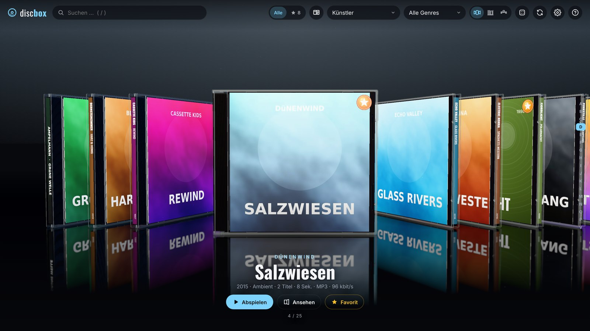

| Regal mit echten CD-Rücken | Aufgeklappte Hülle mit CD und Booklet |
| --- | --- |
| 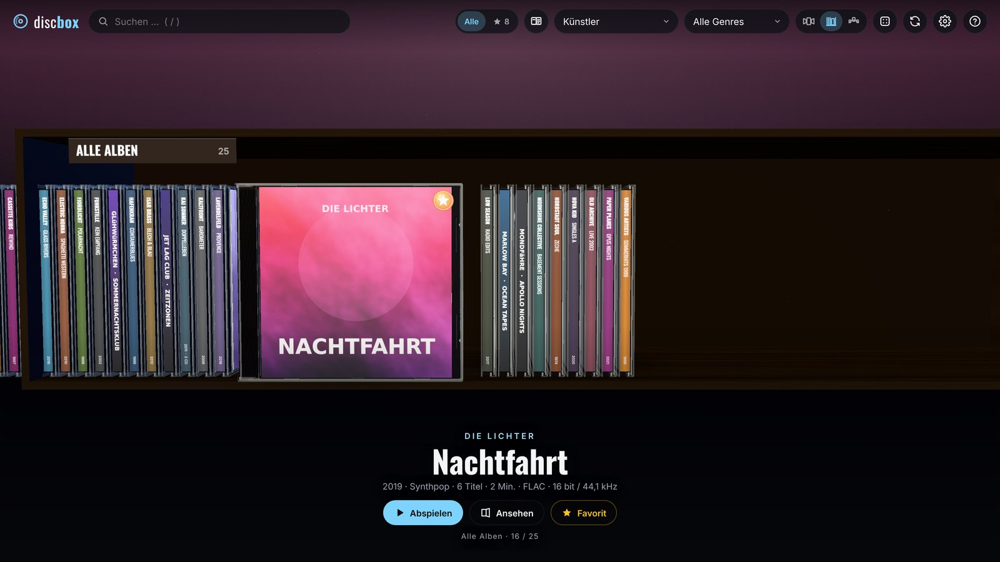 | 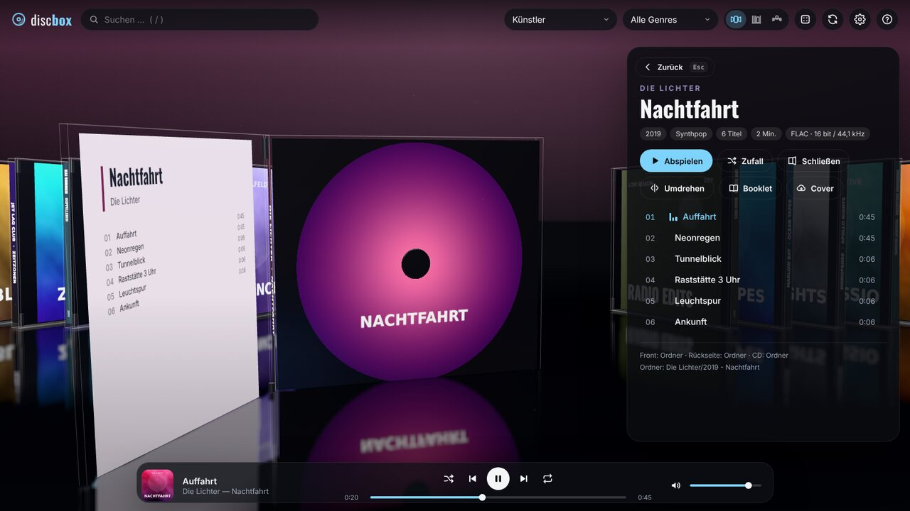 |
| **Rückseite (Scan mit Titelliste)** | **Theme „Neon Arcade“ mit Rad-Anordnung** |
| 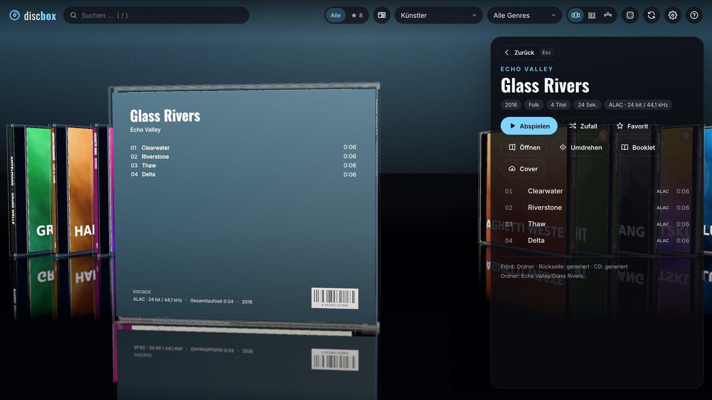 | 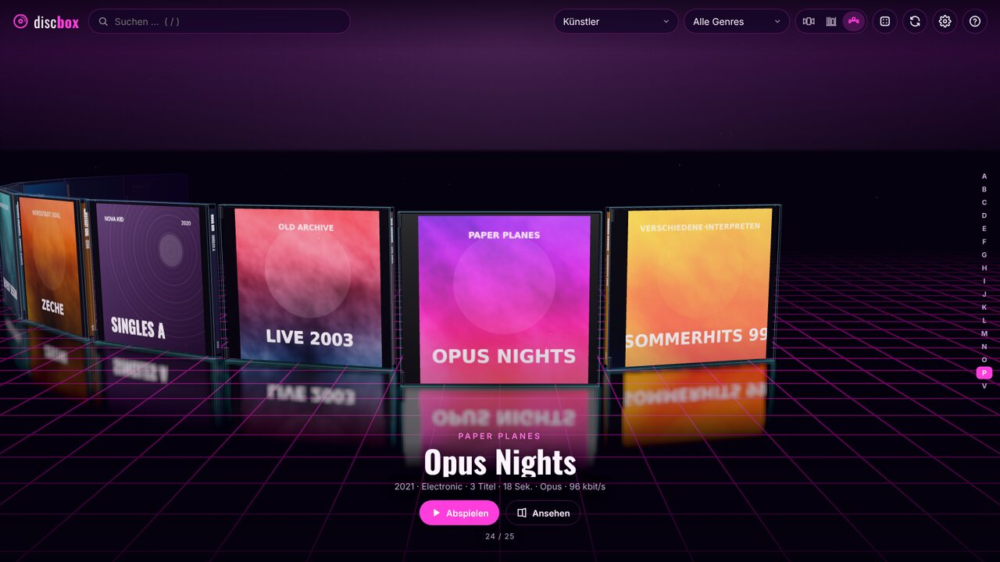 |

## Was discbox kann

- **Originalgetreues Jewel-Case** (142 × 125 × 10,4 mm): klarer Deckel und klares Unterteil mit echten Plastikkanten, schwarzer Tray mit geriffeltem Scharnier-Steg und Rosette. Dazu Frontcover, Rückseite samt CD-Rücken, aufklappbarer Deckel, bedruckte CD und Booklet-Innenseite.
- **Drei Anordnungen:** Coverflow, Regalwand (mehrere Böden übereinander, nach Genre, Jahrzehnt oder Künstler einsortiert, Rücken an Rücken wie im CD-Regal) und Rad.
- **Fünf Themes** (Studio, Neon Arcade, Wohnzimmer, Mitternacht, Galerie hell) plus eigene Themes als JSON-Datei. Der Hintergrund färbt sich passend zum gewählten Album.
- **Cover-Scraping in dieser Reihenfolge:** Bilder im Albumordner → in den Tags eingebettete Bilder → MusicBrainz / Cover Art Archive (Front, Back **und** CD-Aufdruck). Wo nichts zu finden ist, erzeugt discbox selbst ein schlichtes Cover, eine Rückseite mit Titelliste und einen CD-Rücken.
- **Plattenspieler beim Abspielen:** Der Teller dreht sich mit der CD oder einer Schallplatte, der Tonarm folgt dem Album. Per Klick groß, mit der geöffneten Hülle daneben.
- **Favoriten** mit eigener Ansicht (Start-Ansicht), goldenem Aufkleber auf der Hülle und dem Filter **„Nur komplette Cover“**: zeigt nur Alben, bei denen Front- *und* Rückseite vorhanden sind. Alle diese Alben lassen sich mit einem Klick zu Favoriten machen.
- **Wiedergabelisten als selbst gebrannte CDs:** Titel oder ganze Alben per ＋ sammeln und per Ziehen sortieren. Jede Liste steht als eigene Hülle im Regal – mit Cover-Collage, beschriftetem Kreppband, handgeschriebener Titelliste und einem CD-Rohling mit Edding-Schrift.
- **Zuletzt gehört:** eigene Ansicht mit allem, was du gehört hast, das Neueste vorne – eingeteilt in Heute, Gestern, Letzte 7 Tage, Letzte 30 Tage und Früher.
- **Booklet-Ansicht** für alle Scans im Albumordner (auch im Unterordner `Scans/`, `Artwork/` …).
- **Abspielen im Browser:** Warteschlange, Zufall, Wiederholen, Spulen, Medientasten. Der nächste Titel wird vorgeladen. MP3, FLAC, AAC, Opus, Vorbis und WAV laufen direkt; **WMA, ALAC, APE, WavPack, DSD & Co. wandelt der Server mit ffmpeg um** (Spulen funktioniert auch dann).
- **Bedienung per Maus, Touch, Tastatur, TV-Fernbedienung und Gamepad** (Xbox/PlayStation-Controller, wie in LaunchBox Big Box).
- **Schnell auch bei großen Sammlungen:** Es werden nur sichtbare Hüllen gezeichnet, Bilder in passenden Größen geladen. Nach dem ersten Scan liest discbox nur noch neue oder geänderte Dateien ein.
- **Erkennt typische Ordnerstrukturen:** `Künstler/Album`, `Künstler - Album`, `2019 - Album`, Doppel-CDs in `CD1`/`CD2` oder `Album (Disc 2)`, Sampler, Ordner ohne Tags, Windows-Media-Player-Cover (`AlbumArt_{…}_Large.jpg`), Kodi-Disc-Art (`cd.png`, `cdart.png`).
- Optionaler **Passwortschutz**, Bildschirmschoner-Modus, Qualitätsstufen für schwächere Geräte.

---

## Installation auf einem Ugreen-NAS (UGOS Pro)

Du brauchst ein Ugreen-NAS mit Docker-Unterstützung (DXP-Modelle mit UGOS Pro).

### 1. Docker installieren
App Center → **Docker** installieren.

### 2. Ordner für die discbox-Daten anlegen
Lege in der Dateien-App einen Ordner an, z. B. `docker/discbox/data`. Dort speichert discbox Cache, heruntergeladene Cover und Vorschaubilder. Deine Musik wird **nur gelesen**, nie verändert.

Freigegebene Ordner liegen auf dem NAS unter `/volume1/<Name der Freigabe>`. Heißt deine Musik-Freigabe `Musik`, ist der Pfad also `/volume1/Musik`.

### 3. Projekt anlegen
Docker → **Projekt** → **Erstellen**:

1. Name: `discbox`
2. Speicherpfad: z. B. `docker/discbox`
3. Als Compose-Konfiguration den Inhalt von [`docker-compose.yml`](docker-compose.yml) einfügen und die zwei Pfade anpassen:

```yaml
services:
  discbox:
    image: ghcr.io/jackdefjam/discbox:latest
    container_name: discbox
    restart: unless-stopped
    ports:
      - "6619:8080"
    volumes:
      - /volume1/Musik:/music:ro             # ← dein Musikordner
      - /volume1/docker/discbox/data:/data   # ← Daten-Ordner aus Schritt 2
    environment:
      TZ: Europe/Berlin
      ONLINE_COVERS: "true"
```

4. Projekt bereitstellen. Nach dem Start im Browser öffnen: **`http://<IP-deines-NAS>:6619`**

Beim ersten Start liest discbox die Bibliothek ein. Der Fortschritt erscheint direkt in der Oberfläche. Danach sucht discbox im Hintergrund nach fehlenden Covern.

> **Wichtig, solange das Repository privat ist:** Das fertige Image liegt in der GitHub Container Registry und ist dann ebenfalls privat. Dein NAS darf es erst laden, wenn du **eine** der beiden Möglichkeiten nutzt:
> - **Einfach:** Auf GitHub unter *Profil → Packages → discbox → Package settings → Change visibility* auf **Public** stellen. Der Code bleibt privat, nur das Image wird öffentlich.
> - **Privat lassen:** Per SSH auf dem NAS einmalig `docker login ghcr.io -u Jackdefjam` ausführen und als Passwort ein GitHub-Token mit dem Recht `read:packages` eingeben.
>
> Das Image wird bei jedem Push auf `main` automatisch von GitHub Actions gebaut (für Intel/AMD und ARM).

### Aktualisieren
Docker → Projekt `discbox` → Image neu ziehen / Projekt neu bereitstellen. Auf der Kommandozeile: `docker compose pull && docker compose up -d`.

### Ohne fertiges Image (selbst bauen)
```bash
git clone https://github.com/Jackdefjam/discbox.git
cd discbox
docker compose -f docker-compose.build.yml up -d --build
```

---

## Favoriten und komplette Cover

- **Favorit setzen:** ★ unter dem Albumtitel, im Album-Panel, Taste **S** oder rechter Stick-Klick am Controller.
- **Ansicht wechseln:** oben „Alle“, „★ Favoriten“, „Zuletzt gehört“ (Uhr) und „Wiedergabelisten“ – oder Taste **V** (der Reihe nach) bzw. **1** bis **4**. Beim Start zeigt discbox die Favoriten. In den Einstellungen unter *Ansicht → Beim Start zeigen* lässt sich jede der vier Ansichten wählen.
- **Nur komplette Cover:** Das Symbol mit den zwei Karten neben der Ansicht blendet alle Alben aus, denen das Frontcover oder die Rückseite fehlt. Der Filter funktioniert in beiden Ansichten und bleibt gespeichert.
- **Alle kompletten Alben übernehmen:** In der leeren Favoriten-Ansicht oder in den Einstellungen gibt es einen Knopf, der alle Alben mit Front- und Rückseite auf einmal zu Favoriten macht.

Favoriten werden auf dem Server gespeichert (`overrides.json` im Daten-Ordner). Sie gelten auf allen Geräten und überstehen jeden Scan.

## Wiedergabelisten

Jede Wiedergabeliste ist eine selbst gebrannte CD: vorne eine Collage aus bis zu vier Covern der enthaltenen Alben mit dem Namen auf Kreppband, auf dem Rücken ein beschrifteter Papierstreifen, hinten die Titelliste in Handschrift auf Linienpapier. Klappt man die Hülle auf, liegt ein CD-Rohling mit Edding-Beschriftung im klaren Tray, im Booklet steht, aus welchen Alben die Titel stammen.

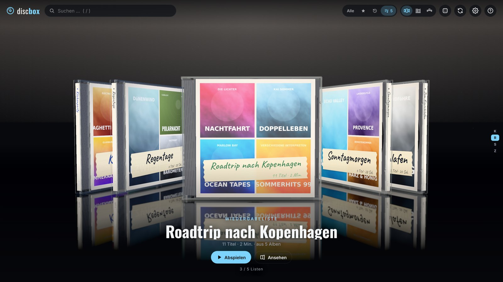

| Geöffnet: CD-Rohling und Titel der Liste | Rückseite mit handgeschriebener Titelliste |
| --- | --- |
| 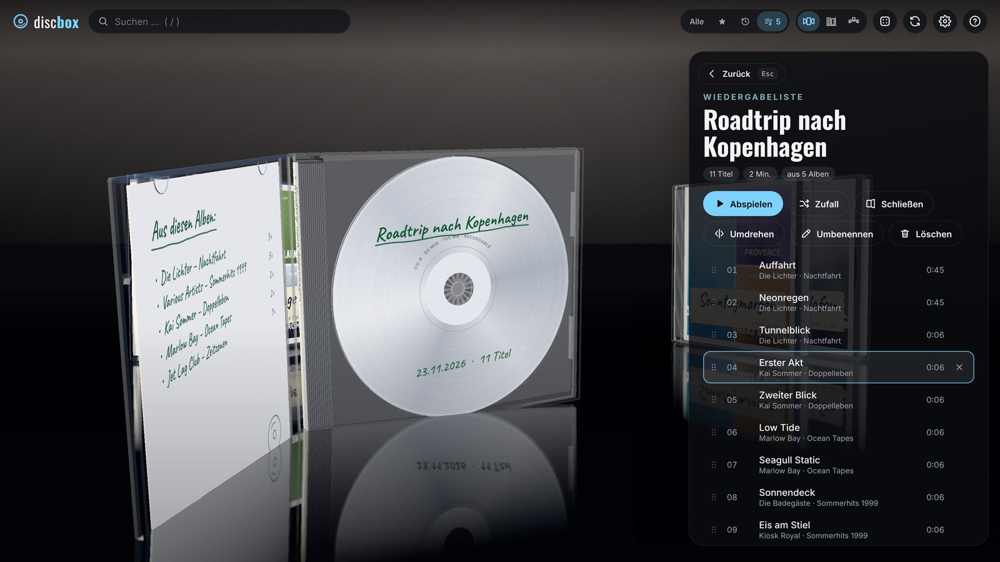 | 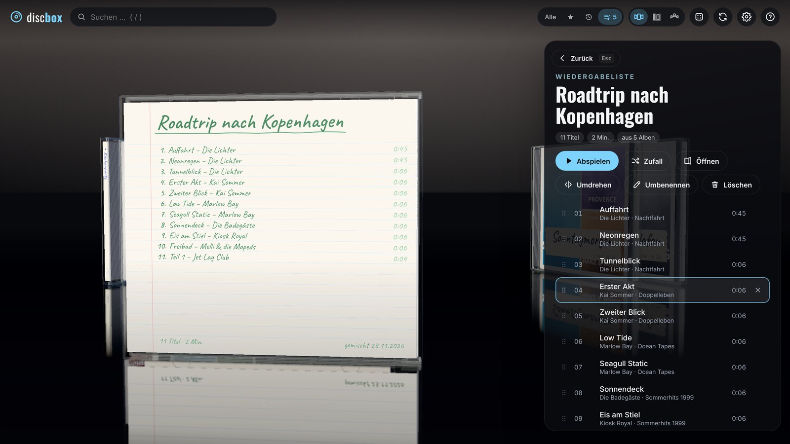 |

- **Titel sammeln:** Im Album-Panel steht bei jedem Titel ein **＋**. Der Knopf **Liste** (unter dem Albumtitel und im Panel) nimmt das ganze Album auf, das Listen-Symbol in der Player-Leiste den gerade laufenden Titel. Taste **W** macht dasselbe: im Panel für den gewählten Titel, sonst für das ganze Album. Es öffnet sich eine Auswahl deiner Listen – oder du legst darin direkt eine neue an. Titel, die schon drin sind, werden nicht doppelt aufgenommen.
- **Ansehen und abspielen:** Ansicht **Wiedergabelisten** (Taste **4**). Listen verhalten sich wie Alben: herausnehmen, drehen, öffnen, abspielen, Zufall. In der Player-Leiste steht über dem Titel, aus welcher Liste er gerade kommt – ein Klick darauf führt zur Liste. Der Plattenspieler legt die gebrannte CD auf und zeigt die Collage als Platten-Label.
- **Bearbeiten** im Panel der Liste: Titel am Griff **⠿** ziehen oder mit **Alt + ↑/↓** verschieben, mit **×** bzw. **Entf** entfernen. **Umbenennen** per Knopf oder Doppelklick auf den Namen, **Löschen** mit zweimal Klicken.
- **Verschwundene Titel:** Wird eine Datei verschoben oder gelöscht, bleibt der Titel durchgestrichen in der Liste stehen und wird beim Abspielen übersprungen. Taucht sie unter demselben Pfad wieder auf, spielt er wieder.

| Titel zu einer Liste hinzufügen | Die gebrannte CD auf dem Plattenspieler |
| --- | --- |
| 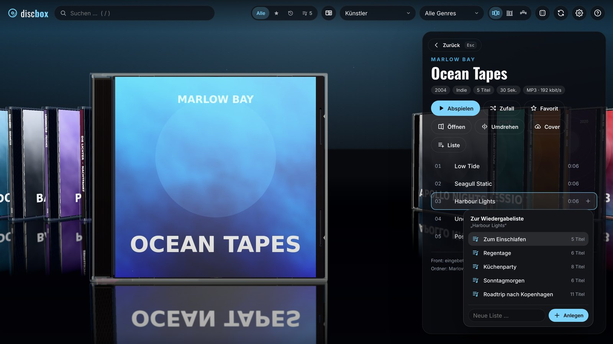 | 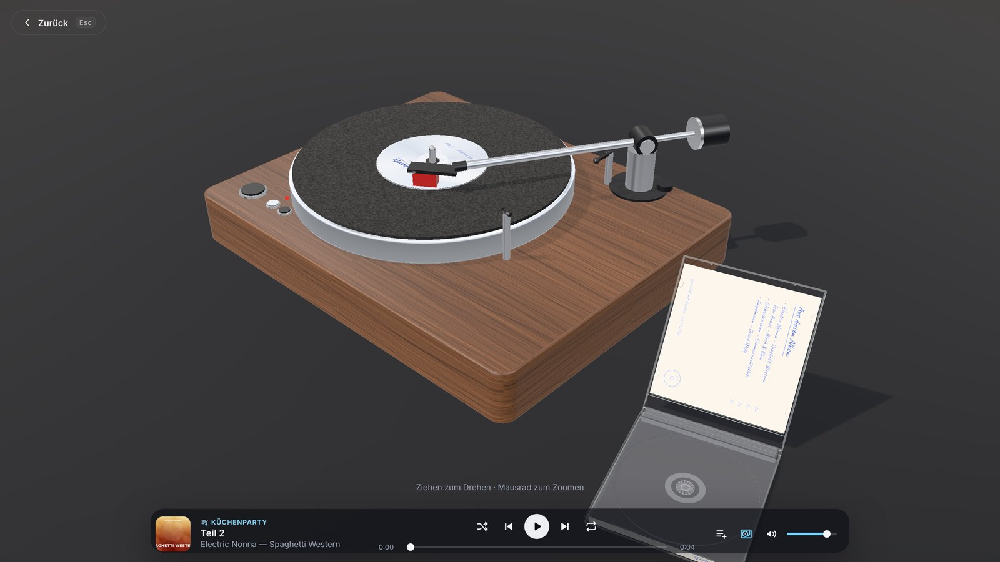 |

## Zuletzt gehört

Die Ansicht **Zuletzt gehört** (Uhr-Symbol oder Taste **3**) zeigt alle Alben, in die du hineingehört hast – das zuletzt gehörte vorne. Ein Album zählt als gehört, sobald ein Titel **30 Sekunden** lief (bei kurzen Titeln die Hälfte); Spulen zählt nicht mit. Die Abschnitte **Heute, Gestern, Letzte 7 Tage, Letzte 30 Tage** und **Früher** erscheinen in der Schnellsprung-Leiste und in der Regalwand als eigene Böden. Unter dem Titel steht, wann du das Album zuletzt gehört hast und wie oft.

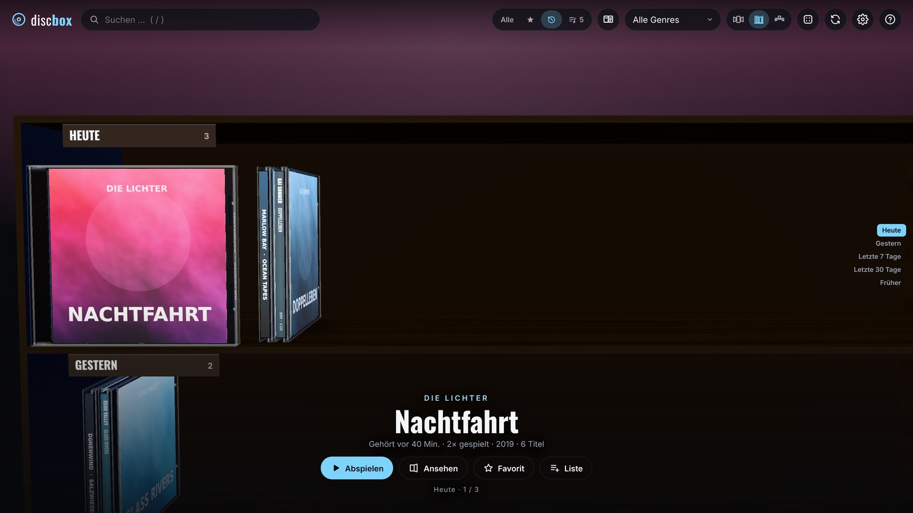

Unter *Einstellungen → Hörverlauf* lässt sich die Aufzeichnung abschalten und der Verlauf löschen. Listen und Verlauf liegen auf dem Server in `collections.json` im Daten-Ordner – sie gelten also auf allen Geräten und überstehen jeden Scan. Für ein Backup reicht es, diese Datei zu sichern.

## Plattenspieler

Sobald ein Album läuft, erscheint unten links ein kleiner Plattenspieler (auf dem Handy oben rechts). Der Teller dreht sich mit 33⅓ Umdrehungen, und der Tonarm folgt dem Fortschritt im Album: Er setzt außen auf und wandert Titel für Titel nach innen. Bei Pause hebt er ab und der Teller läuft aus. Wenn die Wiedergabe endet, fährt der Arm zurück in die Stütze.

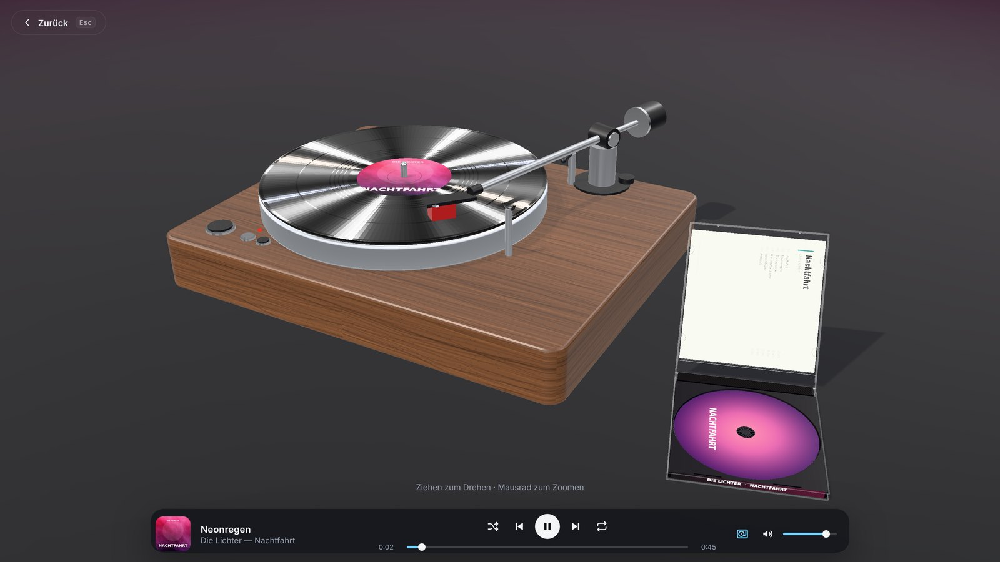

| Mit der CD auf dem Teller | Kleines Bild beim Blättern |
| --- | --- |
| 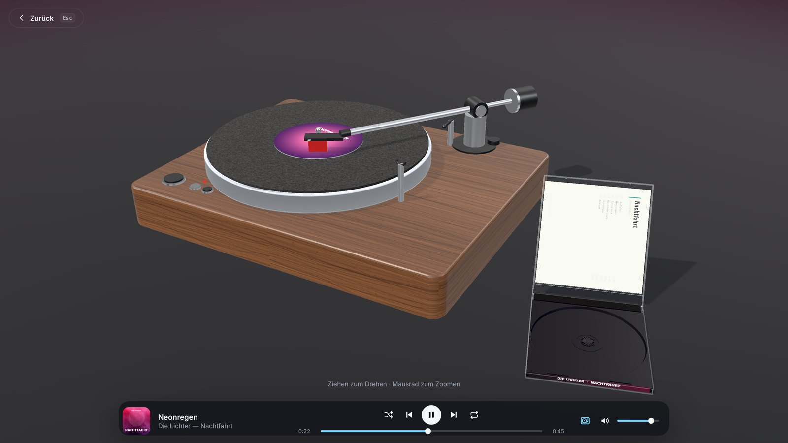 | 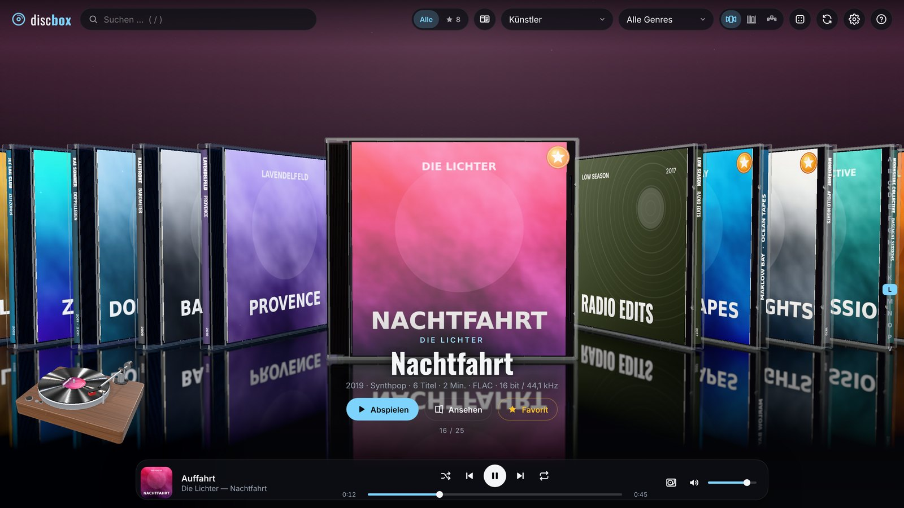 |

- **Groß anzeigen:** Klick auf den kleinen Plattenspieler, das Symbol in der Player-Leiste oder Taste **D**. Ziehen dreht die Ansicht, das Mausrad zoomt. **Esc** führt zurück. Neben dem Plattenspieler liegt die geöffnete Hülle des Albums.
- **CD oder Schallplatte:** In den Einstellungen unter *Plattenspieler → Auf dem Teller*.
  - **CD:** Die CD des Albums liegt auf dem Teller, das Fach der Hülle ist dann leer, auch im Karussell.
  - **Schallplatte:** Eine Platte mit dem Cover als Label. Die Pausen zwischen den Titeln sind als glatte Ringe in den Rillen zu sehen, ihre Abstände richten sich nach den Titellängen.
- **Ausblenden:** *Einstellungen → Plattenspieler → Plattenspieler beim Abspielen zeigen*. Über die Player-Leiste lässt er sich trotzdem jederzeit groß öffnen.

## Regalwand

In der Anordnung **Regal** stehen die Alben auf mehreren Böden übereinander. Jeder Abschnitt beginnt auf einem eigenen Boden mit Schild; lange Abschnitte laufen auf dem nächsten Boden weiter („Forts.“).

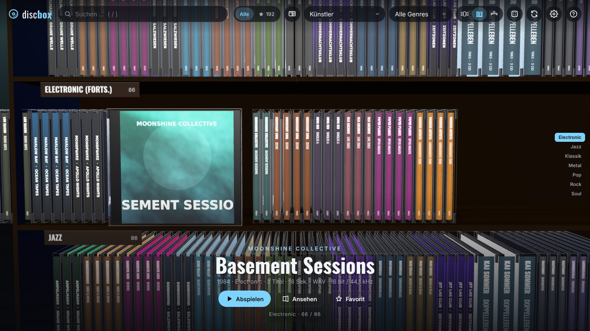

- **Einteilung:** Einstellungen → *Darstellung → Regal einteilen nach*: **Genre** (Standard), **Jahrzehnt**, **Künstler A–Z** oder **ohne Einteilung**. Alben ohne Genre bzw. ohne Jahr landen auf den untersten Böden.
- **Innerhalb eines Bodens** gilt die oben gewählte Sortierung (Künstler, Titel, Jahr …).
- **Bedienung:** ← → blättert auf dem Boden (und am Ende weiter auf den nächsten), **↑ ↓** wechselt den Boden – die Kamera fährt mit. Am Controller dasselbe mit Steuerkreuz oder Stick.
- **Schnellsprung:** Die Leiste am rechten Rand zeigt die Abschnitte (statt A–Z) und springt per Klick zum jeweiligen Boden. Unter dem Albumtitel steht, in welchem Abschnitt und an welcher Stelle das Album steht.

Coverflow und Rad bleiben eine durchgehende Reihe ohne Einteilung.

## Die CD-Hülle

Jedes Album liegt in einem Standard-Jewel-Case, nachgebaut nach dem Original (Philips, 1982) in echten Maßen: 142 × 125 × 10,4 mm.

| Vorne, ohne Booklet | Schräg mit Rücken |
| --- | --- |
| 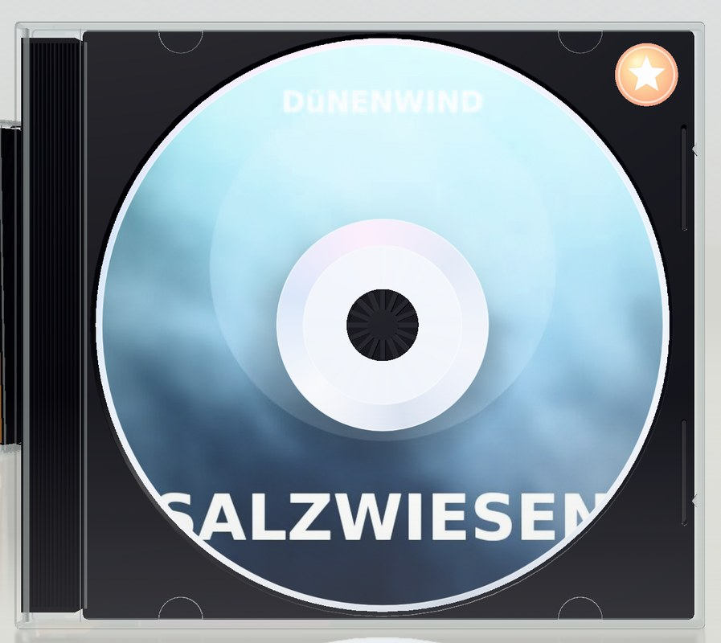 | 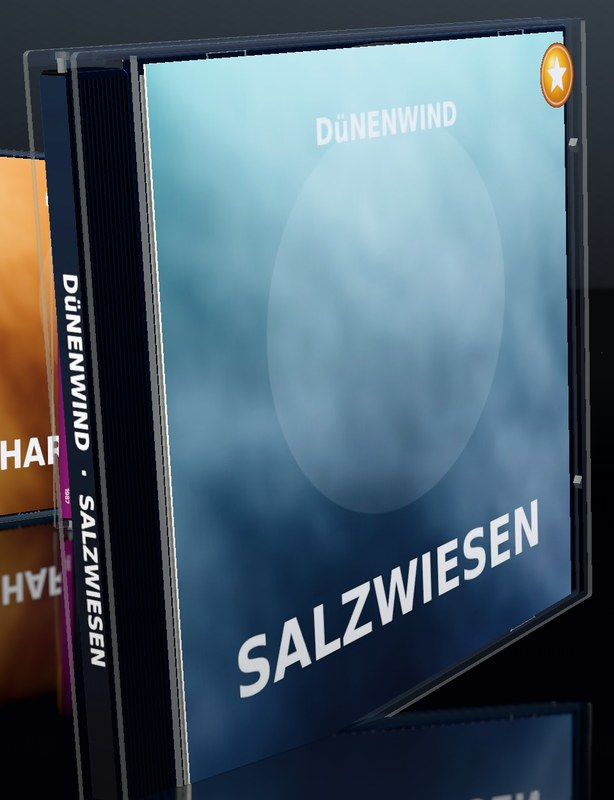 |

- **Klares Unterteil und klarer Deckel** mit Wandstärke, Fasen und hellen Plastikkanten. Durch die Flächen sieht man hindurch, die Kanten wirken wie bei echtem Polystyrol.
- **Schwarzer Tray** mit geriffeltem Steg am Scharnier, CD-Mulde, Rosette mit 16 Zähnen und zwei Rastschlitzen rechts.
- **Scharnier:** Der Deckel dreht sich um die Zapfen seiner Scharnierarme. Innen sind vier halbrunde Booklet-Halter, außerdem die Rastnasen.
- **Papier:** Das Booklet ist 120 × 120 mm groß und liegt unter dem Deckel. Die Tray-Card misst 138 × 118 mm und hat zwei bedruckte Rücken von je 6,5 mm. Ein Scan mit Rücken wird automatisch aufgeteilt.
- In den Einstellungen unter *CD-Hülle* lassen sich die Schriftrichtung auf dem Rücken und die Farbe des Trays (schwarz oder klar) einstellen.

Slim-Cases, Doppel-CD-Hüllen und Digipaks sind vorerst entfernt. Alle Alben, auch solche mit mehreren CDs, liegen in normalen Jewel-Cases.

## Ordner, Cover und Scans

discbox braucht keine bestimmte Ordnerstruktur. Mit Tags (ID3, Vorbis-Kommentare, MP4) klappt es am besten; ohne Tags werden Ordner- und Dateinamen ausgewertet.

| Datei im Albumordner | wird verwendet als |
| --- | --- |
| `cover.jpg`, `front.jpg`, `folder.jpg`, `AlbumArt_…_Large.jpg` | Frontcover |
| `back.jpg`, `rear.jpg`, `inlay.jpg`, `rückseite.jpg` | Rückseite (Tray-Card) |
| `cd.png`, `disc.png`, `cdart.png`, `cd1.jpg` | CD-Aufdruck |
| alle anderen Bilder, auch in `Scans/`, `Artwork/`, `Booklet/` … | Booklet-Ansicht |

**Tipp für Rückseiten:** Ein Scan der kompletten Tray-Card *mit* den beiden schmalen Rücken (ca. 151 × 118 mm, Seitenverhältnis ~1,28) wird automatisch zerlegt: Die Mitte kommt auf die Rückseite, die Ränder werden zu echten CD-Rücken im Regal. Ein Scan ohne Rücken (138 × 118 mm) funktioniert ebenso.

**Eingebettete Bilder:** Hat eine Datei Front- oder Back-Cover in den Tags (z. B. mit Mp3tag, MusicBrainz Picard oder foobar2000 eingebettet), werden diese genutzt, falls im Ordner keine Bilddateien liegen.

**Online:** Fehlt das Frontcover oder die Rückseite, sucht discbox bei MusicBrainz nach der passenden Veröffentlichung und bevorzugt CDs mit der richtigen Titelanzahl. Front, Back und CD-Aufdruck werden aus dem Cover Art Archive geladen. Stimmt der Treffer nicht, kannst du in der Detailansicht unter **Cover** den Link zur richtigen MusicBrainz-Veröffentlichung einfügen. Eigene Dateien im Ordner haben immer Vorrang.

**Mehrere CDs:** Ordner wie `CD1`/`CD2`, `Disc 1`/`Disc 2` oder `Album (CD 2)` werden zu einem Album zusammengeführt. Cover dürfen im übergeordneten Albumordner liegen.

## Formate

| direkt im Browser | per ffmpeg umgewandelt |
| --- | --- |
| MP3, FLAC, AAC/M4A, Opus, Ogg Vorbis*, WAV | WMA, ALAC (Apple Lossless), APE, WavPack, DSD (DSF/DFF), Musepack, TTA, AIFF* |

\* je nach Browser. discbox prüft selbst, was dein Browser kann, und wandelt bei Bedarf um. Standardmäßig wird nach MP3 320 kbit/s umgewandelt (`TRANSCODE_FORMAT=flac` für verlustfrei).

## Bedienung

| | Sammlung | Album (Detailansicht) |
| --- | --- | --- |
| **Maus/Touch** | ziehen oder Mausrad zum Blättern, Klick auf die mittlere Hülle zum Herausnehmen | ziehen zum Drehen, Klick öffnet/schließt die Hülle, Doppelklick dreht sie um |
| **Tastatur** | ← → blättern, ↑ ↓ Regalboden wechseln, Enter ansehen, P abspielen, D Plattenspieler, S Favorit, V Ansicht wechseln, 1–4 Ansicht direkt, W zur Wiedergabeliste, R Zufall, / suchen, L Anordnung, T Theme | ↑ ↓ Titel wählen, Enter abspielen, W Titel zur Liste, F umdrehen, O öffnen, B Booklet, Esc zurück; in Listen Alt + ↑ ↓ verschieben, Entf entfernen |
| **Gamepad** | Steuerkreuz/Stick blättern (im Regal hoch/runter: Boden wechseln), A ansehen, X abspielen, Y Zufall, LB/RB Buchstaben springen, linken Stick drücken: Plattenspieler | A Titel spielen, Y umdrehen, Select öffnen, B zurück, rechter Stick dreht die Hülle |

Leertaste spielt oder pausiert, `[` und `]` wechseln den Titel, `?` zeigt alle Kürzel. Mit einer TV-Fernbedienung (Pfeiltasten, OK, Zurück) lässt sich discbox ebenfalls bedienen.

## Eigene Themes

Lege eine JSON-Datei in den Ordner `themes` innerhalb deines Daten-Ordners (z. B. `/volume1/docker/discbox/data/themes/plattenladen.json`). Sie erscheint nach einem Neuladen der Seite in den Einstellungen. Fehlende Werte werden vom Theme „Studio“ übernommen. Ein vollständiges Beispiel liegt in [`docs/theme-beispiel.json`](docs/theme-beispiel.json).

## Konfiguration

| Variable | Standard | Bedeutung |
| --- | --- | --- |
| `MUSIC_DIR` | `/music` | Musikordner im Container |
| `DATA_DIR` | `/data` | Cache, Cover, Themes |
| `PORT` | `8080` | Port im Container |
| `DISCBOX_PASSWORD` | – | Passwortschutz aktivieren (Benutzername `discbox`, änderbar mit `DISCBOX_USER`) |
| `ONLINE_COVERS` | `true` | fehlende Cover bei MusicBrainz suchen |
| `ONLINE_PACKAGING` | `false` | Verpackungsart (Digipak, Slim …) bei MusicBrainz nachschlagen – derzeit ungenutzt, da discbox nur Jewel-Cases zeigt |
| `MUSICBRAINZ_CONTACT` | Repo-URL | Kontaktangabe für MusicBrainz (am besten deine E-Mail) |
| `SCAN_ON_START` | `true` | beim Start auf Änderungen prüfen |
| `SCAN_INTERVAL_MINUTES` | `360` | regelmäßig neu einlesen (`0` = nie) |
| `SCAN_CONCURRENCY` | `4` | parallele Dateizugriffe beim Einlesen |
| `TRANSCODE` | `auto` | `off` schaltet die Umwandlung ab |
| `TRANSCODE_FORMAT` | `mp3` | `mp3`, `opus` oder `flac` |
| `TRANSCODE_BITRATE` | `320k` | Bitrate für MP3/Opus |
| `LOG_LEVEL` | `info` | `debug`, `info`, `warn`, `error` |

## Zugriff von unterwegs

discbox ist für das Heimnetz gedacht. Für den Zugriff von außen empfiehlt sich ein VPN (z. B. Tailscale oder WireGuard) statt einer Portfreigabe. Wer discbox doch öffentlich erreichbar macht, sollte `DISCBOX_PASSWORD` setzen und einen Reverse-Proxy mit HTTPS davorschalten.

## Fehlerbehebung

- **„Keine Alben gefunden“:** Stimmt der Pfad links von `:/music:ro`? Hat der Container Leserechte? Falls nicht, in der Compose-Datei `user: "UID:GID"` deines NAS-Benutzers setzen.
- **Ruckelt auf dem Fernseher oder einem alten Laptop:** Einstellungen → Qualität „Niedrig“ (ohne Spiegelungen und Partikel).
- **Cover fehlen oder stehen auf dem Kopf (sehr alte Browser):** `?compat` an die Adresse anhängen, z. B. `http://nas:6619/?compat`.
- **Falsches Online-Cover:** Detailansicht → Cover → Link zur richtigen MusicBrainz-Veröffentlichung einfügen. Oder einfach `cover.jpg`/`back.jpg` in den Ordner legen und neu einlesen.
- **Neue Alben erscheinen nicht:** Oben auf ⟳ klicken (liest nur Änderungen) oder in den Einstellungen „Komplett neu einlesen“.

## Entwicklung

Voraussetzungen: Node.js 22, für die Testbibliothek zusätzlich ffmpeg und ImageMagick.

```bash
npm install
npm run testlib   # erzeugt testlib/music mit 24 fiktiven Alben (alle Sonderfälle)
cp .env.example .env
npm run dev       # Server auf :8080, Oberfläche mit Hot-Reload auf http://localhost:5173
npm test          # Tests (Gruppierung, Cover-Erkennung, Online-Suche, API, Streaming, Listen, Verlauf)
npm run build     # Oberfläche für die Produktion bauen
```

```
server/        Node.js + Express: Scanner, Album-Gruppierung, Cover, MusicBrainz, Streaming,
               Wiedergabelisten und Hörverlauf (collections.js)
client/src/
  scene/       three.js: Jewel-Case-Modell, Layouts, Spiegelboden, Texturen, Artwork-Generator,
               gebrannte CDs der Wiedergabelisten (mixtape.js), Plattenspieler
  ui/          Oberfläche, Tastatur/Maus/Gamepad
  core/        API, Zustand, Player, Themes
test/          node:test
scripts/       Testbibliothek
```

## Lizenz und Dank

MIT-Lizenz. Coverdaten stammen von [MusicBrainz](https://musicbrainz.org) und dem [Cover Art Archive](https://coverartarchive.org). discbox baut auf [three.js](https://threejs.org), [music-metadata](https://github.com/Borewit/music-metadata), [sharp](https://sharp.pixelplumbing.com) und [Express](https://expressjs.com) auf. Die Idee stammt von LaunchBox Big Box und [Rycord](https://github.com/ryanpolasky/rycord).
